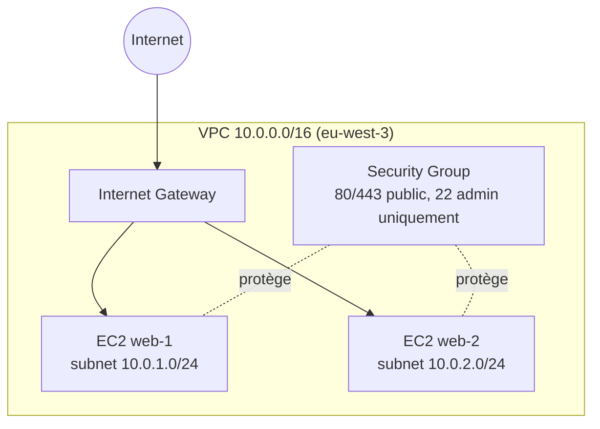
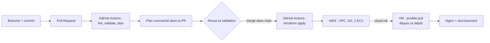

Infrastructure reconstruite via le pipeline GitOps.
# Migration « Zero Touch » vers le Cloud (IaC)

Infrastructure AWS provisionnée par **Terraform**, configurée par **Ansible**,
et déployée via un pipeline **GitOps** (Pull Request → plan → merge → apply).
Aucune ressource n'est créée ni configurée à la main dans la console.

## Architecture



## Flux GitOps



## Stack

| Composant | Rôle |
|---|---|
| Terraform (modules network, security, compute) | Provisionnement AWS |
| Backend S3 (chiffré, versionné, verrou natif) | État partagé |
| Ansible (rôles common, security, nginx) | Configuration des serveurs |
| cloud-init + ansible-pull | Configuration automatique au démarrage |
| GitHub Actions + OIDC | Pipeline sans clé AWS stockée |

## Arborescence

```
iac-zero-touch/
├── .github/workflows/
│   ├── terraform-plan.yml       # sur Pull Request
│   └── terraform-apply.yml      # sur merge dans main
├── terraform/
│   ├── backend.tf
│   ├── providers.tf
│   ├── variables.tf
│   ├── main.tf
│   ├── outputs.tf
│   └── modules/
│       ├── network/             # VPC, subnets, IGW, routes
│       ├── security/            # Security Groups
│       └── compute/             # EC2 x2
├── ansible/
│   ├── ansible.cfg
│   ├── inventory/
│   ├── site.yml
│   └── roles/
│       ├── common/              # MAJ système, paquets de base
│       ├── security/            # UFW, SSH durci, fail2ban
│       └── nginx/               # install + config + page de test
├── docs/                        # schémas, captures, rapport
├── .gitignore                   # *.tfstate, .terraform/, *.pem
└── README.md
```

## Prérequis (bootstrap unique, via CLI)

1. Bucket S3 pour l'état Terraform
2. Fournisseur OIDC GitHub et rôle IAM `github-actions-terraform`
3. Secrets GitHub : `ADMIN_CIDR`, `SSH_PUBLIC_KEY` ; variable : `AWS_ROLE_ARN`

## Utilisation

- Modifier l'infra : branche → PR → relire le plan → merge
- Modifier la config serveur : modifier `ansible/` → PR → merge (les VM se mettent à jour via cron)
- Tout détruire : `terraform destroy` (workflows désactivés)

## Sécurité

OIDC (pas de clé), IMDSv2 obligatoire, disques chiffrés, SSH limité à l'IP admin,
UFW + fail2ban, SSH durci, mises à jour automatiques, variable sensible masquée.

## Démonstration

Captures dans `docs/preuves/` : création, modification par PR, mise à jour Ansible, dérive.